## Hello! I'm Davis Liu

I'm a Software Engineering student at the University of Waterloo. I enjoy building cool projects, exploring low-level systems, and experimenting with new technologies. I'm also interested in competitive programming, robotics, and mathematics.

### Links:

- **Personal Website:** [davisliu2006.github.io](https://davisliu2006.github.io)
- **LinkedIn:** [Davis Liu](https://www.linkedin.com/in/davis-liu-5178b6252/)
- **DMOJ:** [DavisLiu](https://dmoj.ca/user/DavisLiu)

-----

    
    

